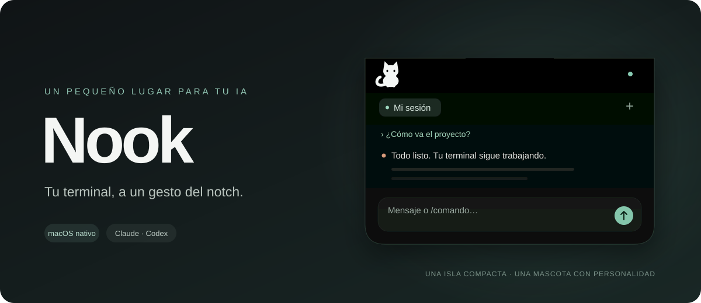
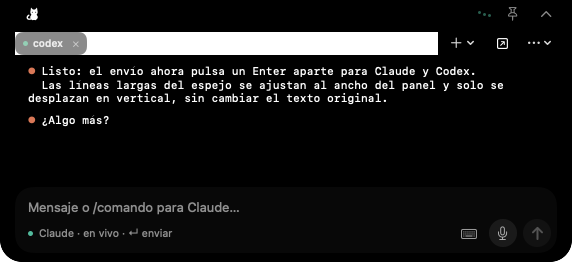

<div align="center">



**A little cat. A compact island. Your terminal, within reach.**


[Website & demos](https://danielssf.github.io/Nook/) · [Download Nook](https://github.com/DANIELSSF/Nook/releases/latest/download/Nook.zip) · [Releases](https://github.com/DANIELSSF/Nook/releases) · [Usage guide (ES)](docs/USAGE.md)

</div>

Nook is a native macOS app that brings your terminal sessions to the notch. Follow your AI's work, send messages, and catch requests for your attention without switching away from what you're doing. Move the pointer toward the cat to expand the island from the top edge of your screen.

<div align="center">



<sub>App-rendered preview with a sample conversation. The app's current interface is in Spanish.</sub>

</div>

## Your session stays yours

- **Connect individual tabs.** Drag the cat to macOS Terminal or choose the session you want to follow.
- **Open new terminals in Terminal.** **+ → Terminal / Claude Code / Codex**, or **Nueva terminal en una carpeta…** (New terminal in a folder…), opens a new tab (⌘T) in Terminal's front window, or a new window when it has none or Nook lacks Accessibility permission. The tab runs the shell, `claude`, or `codex` in the folder (the shell stays when the CLI exits), and Nook connects and names it ("Claude Code", "Claude Code 2"…).
- **Rearrange tabs like a browser's.** Drag a tab sideways: it lifts, follows the pointer, the others spring aside as it passes, and it settles where you let go. Clicks, the ✕, the context menu and the agent badge keep working, the strip scrolls at its edges, and the order is remembered (with Reduce Motion the tab only changes place).
- **Hear your alerts, if you like.** A finished turn, a question and an error each have their own Mac sound (**Ajustes → Sonido**, Settings → Sound), with a master switch, a volume, and a switch for every tab (right-click a tab, its **…** menu or its editor); a muted tab carries a slashed speaker.
- **Write comfortably.** Send multiline messages (long ones arrive whole, as a single paste), keep a draft for each tab, browse message history, and complete `/` commands for Claude Code and Codex.
- **Return to the original terminal.** Bring its window forward with one button. Closing a Nook tab keeps the original terminal session open.
- **Start from a home, not an empty box.** With no tab open, the island shows its home: the real cat, large, watching the pointer, answering a click and ready to be dragged onto a Terminal window; cards to start **Claude Code**, **Codex** or a **Terminal** tab; and a button to connect a terminal you already use. The first time Nook runs, the cat waves and says what it does (**Ajustes → Isla → Bienvenida**, Settings → Island → Welcome, plays it again).
- **Make it your own.** Rename tabs, give each one a soft color and a small icon that moves while its AI works, and adjust the panel and text size. A tab is recognized by its TTY and login time, so a new tab that reuses a closed one's TTY never inherits its name, color, icon, or history.
- **Follow Claude's work.** Read conversations, answer questions and permission requests, and check summaries and subagent activity. A message you send while Claude is busy shows as queued until Claude takes it. Claude's startup banner and settings warnings stay out of the chat: a quiet line shows the model, plan, folder, and version, and an amber pill opens the warnings.
- **Answer questions in full.** Question cards show the whole question, every option with its full description, multi-select boxes, tabs for dialogs with several questions, and the `/model` picker as a numbered «Elegir modelo» card with its effort row. A final «Revisa tus respuestas» (Review your answers) step highlights each answer before you send, and long cards scroll instead of cutting anything off.
- **Claude inside saved tmux sessions.** Nook no longer creates sessions of its own, but the ones it saved before keep working: run `claude` or `codex` in one and it gets the same conversation view as a Terminal tab; a plain shell still shows its terminal.
- **Control Claude without typing.** Four round, symbol-only chips next to the message field set Claude's permission mode (Normal, Accept edits, Plan, Auto, No permissions), model and reasoning effort, and open its usage: the mode in its own symbol and color, the model as its family's symbol (mountains, flower, leaf, book), the effort as a ring that fills from a fifth («Bajo») to a full disc («Máximo»). Names are in tooltips and VoiceOver. The model chip opens Claude Code's own list for your account, read from its local model cache so new models appear on their own, in the picker's order and with descriptions; pick a row and apply it as the default for new sessions («Usar por defecto») or for this session only («Solo esta sesión»). Claude's own `/model` picker shows as the same list in an «Elegir modelo» card. A `/effort` or `/model` that works leaves no trace in the chat; errors stay under their command. The status line also says when Claude is waiting on background agents.
- **Read code clearly.** Claude responses support formatted text and highlighted code. Inline edits show numbered lines with red and green backgrounds for removed and added code.
- **Explore subagent conversations.** Open an agent from its tab badge or the composer capsule to see its name, model, status, and conversation. Nook also reads Claude's own on-screen list of agents, so what each one is doing stays live, and an agent Claude wakes up later shows as working again. The composer continues to send messages to the main Claude session.
- **Use Claude's interactive panels.** View panels such as `/status`, `/config`, and `/mcp`, navigate with familiar keys, and return to the conversation with your draft preserved. `/usage` (or the gauge button) shows each limit as a meter with when it resets. With *Live limits* on (Settings → Permissions), the card also fills in what Claude hands Nook on every reply (the session and week limits, cost and context), so a Terminal tab needs no keys or scrolling. With it on, the gauge opens Nook's own usage card instead, typing nothing in the terminal: the session and week limits, each model's week (such as Fable, from the last usage reading Claude keeps in its `.claude.json`, which Nook only reads) and the session's figures; *Detalle en Claude* opens the full `/usage`. That data stays on your Mac, in a private temp folder only your user can read (each file is deleted an hour after its last update, and the whole folder when you turn it off).
- **See activity at a glance.** The notch badge shows working subagents; hover for details or click to open their tab and list.
- **Add context.** Dictate a draft, paste images (they show as thumbnails and need no permission), or drag files into your message.
- **Stay light.** Nook uses about 55–65 MB with several tabs open (its helper stays near 20 MB). It watches its own memory: past safe limits it frees hidden tabs' text and restarts its helper, and it warns you if usage gets very high.
- **Enjoy a cat with personality.** Curious glances, grooming, stretching, yawns, hunts, naps, play, and celebrations. Pick its character, activity, coat, and accessory in Settings. It respects Reduce Motion and eases off on Low Power Mode. If Nook starts at night the cat is asleep, curled up in the notch and in the header; a click wakes it gently (an ear flick, eyes opening slowly, a stretch, a yawn), and switching the island to the light theme wakes it too, squinting at the glow first.
- **Quit with a question.** **… → Salir de Nook** (or ⌘Q) asks "¿Seguro que quieres salir?" inside the island, with a sad cat: **Quedarme** (Enter, Esc, or a click outside) stays, **Salir** quits, and ⌘Q again quits too. Your terminals keep running either way.
- **Buttons that answer.** Every button dips when pressed and its icon makes one small gesture of its own (the pin tilts, arrows nudge the way they point, **+** and ✕ turn, the microphone pulses). Reduce Motion turns it all off.

Nook no longer creates tmux sessions of its own: new terminals are Terminal tabs. Sessions saved earlier keep working, and any tmux session you already run can still be connected. The island grows out of the notch: its top strip (with the cat) and the collapsed island stay black, like the hardware, and the body of the open island follows the theme you pick in Settings: **System** (it follows macOS, live), **Light** (a warm paper set into the notch's black frame) or **Dark**.

## Get started

1. [Download the latest Nook.zip](https://github.com/DANIELSSF/Nook/releases/latest/download/Nook.zip), unzip it, and move **Nook.app** to Applications. The current build requires **macOS 27 or later on Apple Silicon**; it is signed ad hoc and is not notarized. Read the [release notes](https://github.com/DANIELSSF/Nook/releases) before installing.
2. Open Nook and choose **Conectar una terminal…** (Connect a terminal), drag the cat to a Terminal window, or start a new terminal with **+**.
3. Allow Nook to control Terminal when macOS asks.
4. Move the pointer toward the cat to expand the island, then click to start typing.

In **Ajustes → Permisos** (Settings → Permissions), you can review Automation, Accessibility, microphone, speech recognition, and Claude notifications. Accessibility lets Nook press arrow keys, Tab, and Escape in Claude's menus and pickers (options, models), ⇧Tab for its mode, and ⌘T so new terminals open as tabs of your Terminal window (without it they open as windows). Dictation prepares a draft; you choose when to send it.

## Build

The current packaged app requires **macOS 27 or later** and targets **Apple Silicon**. You'll need Swift 6 / Xcode, the command line tools, and Homebrew.

```sh
git clone https://github.com/DANIELSSF/Nook.git
cd Nook
brew install libevent
bash Scripts/build-app.sh release
open dist/Nook.app
```

The first build downloads SwiftTerm and the tmux source. The resulting app is signed locally with an ad hoc signature and is not yet notarized. Install and authenticate the Claude Code and Codex CLIs separately.

## Current scope

Direct connections currently support **macOS Terminal**. iTerm2, Ghostty, Warp, and editor terminals do not yet have direct integration. Terminal tabs use a text mirror; tmux sessions that Nook saved earlier use the integrated terminal emulator.

Conversation transcripts, summaries, subagent views, interactive Claude panels, and the mode and model chips are specific to Claude Code. In Terminal tabs, arrow keys, Tab, Escape, the mode chip, some model choices, and opening new terminals as tabs require Accessibility permission; sending messages and pasting images do not. See the [usage guide (Spanish)](docs/USAGE.md) for details on each mode.

Capture exclusion is **experimental and off by default**. Its effectiveness depends on macOS and the recording or screen-sharing app; verify the receiving view before relying on it. Nook remains visible in process monitors. See [capture privacy](docs/PRIVACY.md) for its scope and limitations.

## Website

Explore the interactive demos at **[danielssf.github.io/Nook](https://danielssf.github.io/Nook/)**. The Spanish-language website lives in [`site/`](site/README.md), with its text in `site/src/i18n/es.ts` and download links in `site/src/config.ts`.

GitHub Pages serves the compiled website from the root of the **`gh-pages`** branch, including `.nojekyll`. The app and website source stay on `main`; build output is published separately. See the [website deployment guide](site/README.md#deploying-to-github-pages).

## Built for macOS

**SwiftUI · AppKit · SwiftTerm · tmux · Speech**

[Architecture and tests (ES)](docs/DEVELOPMENT.md) · [Capture privacy (experimental)](docs/PRIVACY.md) · [Contributing (ES)](CONTRIBUTING.md) · [Third-party notices (ES)](THIRD_PARTY_NOTICES.md)

Nook is in active development. A redistribution license has not yet been chosen for the project's own code; dependencies retain their original licenses.
